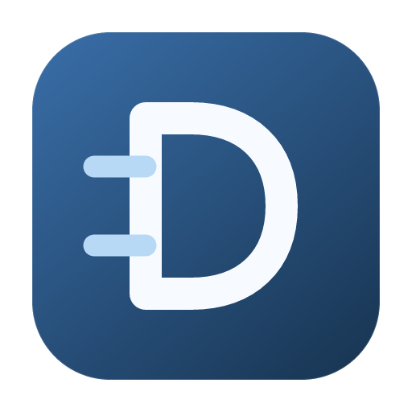
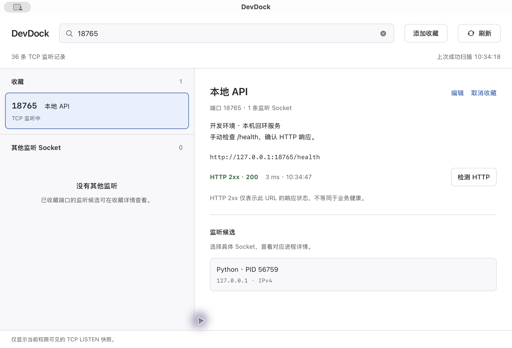
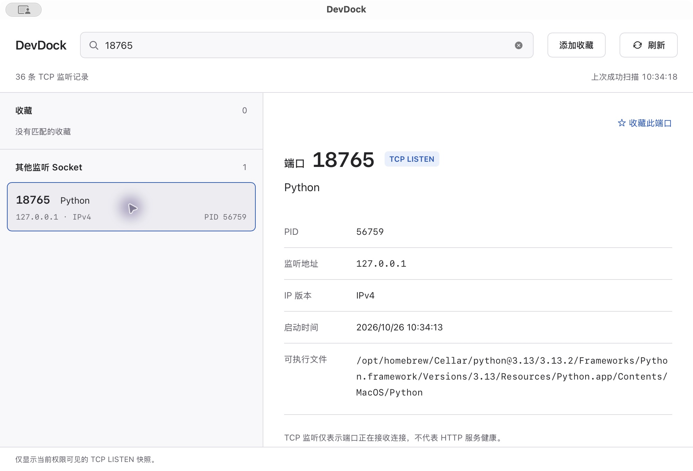
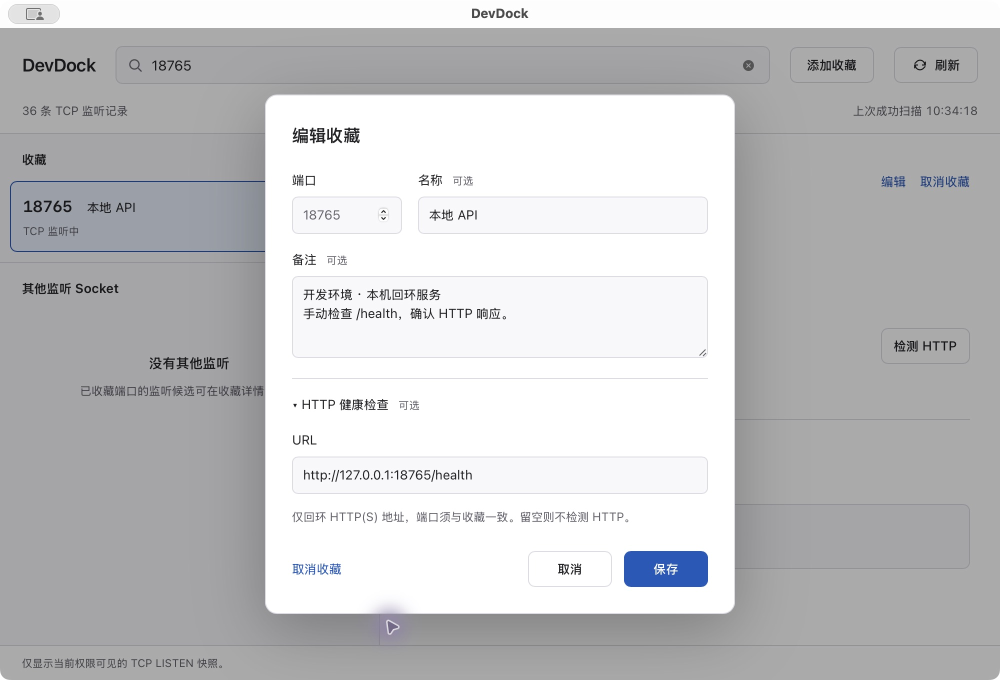

<p align="center">
  
</p>

<h1 align="center">DevDock</h1>

<p align="center">查看谁占用了端口，收藏常用服务，按需检查 HTTP 状态。</p>
<p align="center"><strong>macOS</strong> · Tauri 2 · Vue 3 · Rust · MIT</p>
<p align="center">
  <a href="https://github.com/01Petard/DevDeck/releases">下载</a> ·
  <a href="#快速上手">使用说明</a> ·
  <a href="#源码构建">源码构建</a> ·
  <a href="docs/00_开始开发.md">文档</a> ·
  <a href="https://github.com/01Petard/DevDeck/issues">反馈问题</a>
</p>



<p align="center">真实 macOS 原生窗口：收藏、备注和手动 HTTP 检测。截图中的端口来自临时本机服务。</p>

## 功能

- **查端口**：扫描本机 TCP LISTEN，按端口、PID、进程名搜索，分别保留 IPv4 / IPv6 Socket。
- **看进程**：展示真实 PID、监听地址、可获取的启动时间和可执行文件路径。
- **存收藏**：一键添加或取消，支持未启动端口；名称、多行备注均可选，重启后保留。
- **测 HTTP**：手动检测显式配置的回环 HTTP(S) URL，区分 2xx、非 2xx、连接失败和超时。
- **安全停止**：明确确认后发送 SIGTERM，后端重新校验进程身份与监听端口；未确认退出时如实提示。
- **原生窗口**：跟随系统深浅主题；关闭窗口后应用保留在后台，点击 Dock 图标可快速恢复，选择 macOS 菜单栏中的“退出 DevDock”才会结束程序。安装后无需 Node.js 或 Rust 运行环境。

DevDock 聚焦本机端口排查，不包含远程管理、进程启动、Docker 管理或后台监控。

## 安装

在 [Releases](https://github.com/01Petard/DevDeck/releases) 查找可用的 macOS 安装包；若尚未提供预编译包，请按下文从源码构建。

1. 打开 `.dmg`，将 **DevDock** 拖入 **Applications**。
2. 从 Finder 的“应用程序”启动 DevDock。关闭窗口按钮只隐藏窗口；点击 Dock 图标重新显示，使用菜单栏“DevDock → 退出 DevDock”或 `⌘Q` 退出程序。

已在 **macOS 15.7.5 / Apple Silicon** 上验证。构建声明最低 macOS 11.0，其他系统版本和 Intel Mac 尚未验证。当前本地打包流程未完成 Developer ID 签名与 Apple 公证，不代表已通过公众分发验证；不要通过关闭系统安全保护来解决安装问题。

## 快速上手

1. **找到端口**：启动后自动扫描；输入端口、PID 或进程名筛选，点击记录查看详情。“刷新”只重新扫描 TCP。
2. **收藏常用端口**：点击“收藏此端口”一键保存，也可用“添加收藏”录入尚未监听的端口。名称和备注在“编辑”中填写。
3. **检测 HTTP**：编辑收藏时展开可选的“HTTP 健康检查”，填写与收藏端口一致的 URL，例如 `http://127.0.0.1:8080/health`，保存后手动点击“检测 HTTP”。
4. **结束进程**：选择具体监听 Socket，点击“结束进程…”，核对 PID 和受影响端口后确认。默认焦点为“取消”。

### 监听与进程详情



TCP 监听不等于 HTTP 健康。扫描是当前权限可见的快照；无法读取的进程字段显示“不可用”。

### 简单收藏，可选备注和 HTTP 配置



HTTP 只允许 `localhost`、`127.0.0.1`、`[::1]`，固定 GET、3 秒超时，禁用代理和重定向。无 URL 时不会发送请求；2xx 仅代表该 URL 的响应状态。

## 源码构建

准备 macOS、Xcode Command Line Tools、Node.js 24、pnpm 11.5.2，以及 Rust stable（当前锁定依赖要求 Rust ≥1.95）。

```sh
git clone https://github.com/01Petard/DevDeck.git
cd DevDeck
pnpm install --frozen-lockfile

# 运行前端测试，通过后构建 App + DMG；本地自用采用 ad-hoc 签名
APPLE_SIGNING_IDENTITY=- pnpm release
```

产物位于：

```text
src-tauri/target/release/bundle/
├── macos/DevDock.app
└── dmg/DevDock_<版本>_aarch64.dmg
```

上面的 DMG 文件名对应 Apple Silicon 构建，实际名称以 Tauri 输出为准。

| 命令 | 用途 |
|---|---|
| `pnpm tauri dev` | 启动原生开发窗口，需要 Rust 在 PATH 中 |
| `pnpm test` | 运行前端逻辑测试 |
| `pnpm build` | 类型检查并构建前端到 `dist/`，不生成 App |
| `pnpm build:app` | 构建 macOS App 和 DMG |
| `pnpm release` | 前端测试通过后执行 `build:app`，生成本地产物，不上传或发布 |

打包脚本已补充常见 rustup / Homebrew 安装路径。**`src-tauri/target/` 可以完整删除**，它只包含构建产物与缓存；下一次打包会重新生成。Rust 测试、版本同步与故障排查见 [开发指南](docs/开发指南.md)。

## 文档

- [文档导航](docs/00_开始开发.md)：按使用、开发、验收和历史记录查找资料。
- [开发指南](docs/开发指南.md)：环境、命令、打包、修改版本与配置恢复。
- [产品范围](docs/01_产品需求_PRD.md) · [技术设计](docs/02_技术设计.md) · [数据契约](docs/03_数据契约与错误码.md)。
- [测试与发布](docs/06_测试与发布.md) · [v0.1.0 验收记录](docs/08_发布验收记录.md)。

## 参与贡献

欢迎通过 [Issues](https://github.com/01Petard/DevDeck/issues) 报告问题或提出建议，也欢迎提交 Pull Request。问题报告请附 macOS 版本、芯片架构、DevDock 版本、复现步骤和脱敏后的报错。

修改前请阅读 [AGENTS.md](AGENTS.md) 和对应规格，保持本机工具的功能边界。涉及进程停止的验证只能操作本次自行创建的临时服务；请按 [测试与发布](docs/06_测试与发布.md) 提供适合改动的验证证据。

## 许可证

[MIT License](LICENSE) · Copyright © 2026 DevDock contributors.
